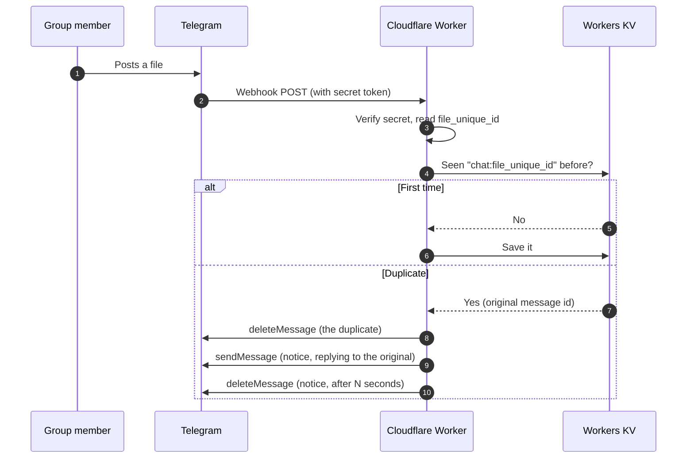

<div align="center">

# 🧹 Telegram Dedupe Bot

**Automatically deletes files that were already posted in your Telegram group.**
Serverless, free, and set up in about 10 minutes.


</div>

---

## ✨ Features

- 🗑 **Deletes duplicate files instantly**: documents, photos, videos, audio, voice notes, GIFs and video notes
- 🔕 **Self-cleaning notices**: a short "removed a duplicate" message that deletes itself after a few seconds
- 📊 **`/dupestats`**: shows how many duplicates were removed in the group
- 🔒 **Secure webhook**: only requests carrying your secret token are accepted
- ☁️ **No server to run**: runs on Cloudflare's free tier, always on
- ⚙️ **Configurable**: notices on/off, notice lifetime, and how long files are remembered

---

## 🧠 How it works

Every file on Telegram has a **`file_unique_id`**. It is the same for identical
files no matter who sends or forwards them. The bot stores each ID it sees,
and when one shows up again, it deletes the new message.



Files are tracked **per group**, so the same file can still be posted once in
each of several groups.

---

## 📋 What you need

| Requirement | Why | Cost |
|---|---|---|
| A **Telegram bot** from [@BotFather](https://t.me/BotFather) | The bot that joins your group | Free |
| A **Cloudflare account** | Hosts the Worker and the KV store | Free tier |
| **Node.js 18+** | Runs the `wrangler` CLI to deploy | Free |
| **Admin rights** in the group | So the bot can delete messages | — |

> **Free tier limits:** Workers allow 100,000 requests/day and KV allows 1,000 writes/day.
> One write is used per *new* file, which is plenty for most groups.

---

## 🚀 Setup

### 1. Create the bot
Message **[@BotFather](https://t.me/BotFather)**, send `/newbot`, and follow the prompts.
Keep the **token** it gives you private.

### 2. Get the code
```bash
git clone https://github.com/<you>/telegram-dedupe-bot.git
cd telegram-dedupe-bot
```

### 3. Log in to Cloudflare
```bash
npx wrangler login
```
> 💡 **Windows PowerShell:** if you see *"running scripts is disabled"*, use `npx.cmd` instead of `npx`.

### 4. Create the KV store
```bash
npx wrangler kv namespace create DUPES
```
Copy the `id` it prints into `wrangler.toml`:
```toml
[[kv_namespaces]]
binding = "DUPES"
id = "paste-the-id-here"
```

### 5. Deploy
```bash
npx wrangler deploy
```
Note the URL it prints, e.g. `https://telegram-dedupe-bot.<your-subdomain>.workers.dev`.
On a brand-new account, its HTTPS certificate can take a few minutes to become active.

### 6. Connect Telegram to the Worker

<details open>
<summary><b>Windows (helper script)</b></summary>

```powershell
powershell -ExecutionPolicy Bypass -File .\scripts\connect-telegram.ps1 -WorkerUrl https://telegram-dedupe-bot.<your-subdomain>.workers.dev
```
It asks for your token with hidden input, stores the token and a random webhook
secret on the Worker, and registers the webhook.
</details>

<details>
<summary><b>macOS / Linux (manual)</b></summary>

```bash
npx wrangler secret put BOT_TOKEN          # paste your bot token
npx wrangler secret put WEBHOOK_SECRET     # type any random string (A-Z, a-z, 0-9, _ -)

curl -X POST "https://api.telegram.org/bot<BOT_TOKEN>/setWebhook" \
  -H "Content-Type: application/json" \
  -d '{"url":"<WORKER_URL>","secret_token":"<WEBHOOK_SECRET>","allowed_updates":["message","channel_post"]}'
```
</details>

You should see `"ok": true`.

### 7. Add the bot to your group
1. Add the bot as a member.
2. Promote it to **admin** and turn on **Delete messages**.
3. Test it: post a photo, then post the same photo again. The second copy disappears. 🎉

---

## ⚙️ Configuration

Set these in `wrangler.toml` under `[vars]`, then run `npx wrangler deploy` again.

| Variable | Default | Description |
|---|---|---|
| `NOTIFY` | `"true"` | Post a notice when a duplicate is removed |
| `NOTICE_SECONDS` | `"5"` | Delete the notice after this many seconds (1–25). `0` keeps it |
| `REMEMBER_DAYS` | `"0"` | Forget files after this many days. `0` remembers them forever |

**Secrets** (set with `wrangler secret put`, never committed):

| Secret | Description |
|---|---|
| `BOT_TOKEN` | Your bot token from BotFather |
| `WEBHOOK_SECRET` | Random string Telegram sends with each request, so the Worker can reject fake ones |

---

## 💬 Commands

| Command | What it does |
|---|---|
| `/dupestats` | Shows how many duplicates were removed in this group |

---

## 🩺 Troubleshooting

Run the status checker. It shows whether Telegram can reach your Worker, and the last delivery error if there was one:
```powershell
powershell -ExecutionPolicy Bypass -File .\scripts\check-bot.ps1
```

| Symptom | Cause | Fix |
|---|---|---|
| `401 Unauthorized` in *Last error* | Webhook secret mismatch | Run step 6 again |
| `SSL error` in *Last error* | New `workers.dev` certificate not ready yet | Wait a few minutes. Telegram retries automatically |
| Nothing is deleted, no errors | Bot isn't an admin, or lacks *Delete messages* | Promote it and turn the permission on |
| Old duplicates are still there | Bots can't read group history | Only files posted **after** the bot joins are tracked |

Live logs: `npx wrangler tail`

---

## ⚠️ Limitations

- **No history scan**: the Bot API can't read messages sent before the bot joined.
- **Exact matches only**: a re-compressed or edited file gets a new `file_unique_id`, so it isn't detected as a duplicate.
- **Stickers and text** are ignored on purpose.
- **Notice lifetime is capped at 25 seconds**, because a Worker can only keep working for a limited time after it responds.

---

## 📁 Project structure

```
telegram-dedupe-bot/
├── src/
│   └── index.js               # The Worker: webhook handler + dedupe logic
├── scripts/
│   ├── connect-telegram.ps1   # Sets secrets and registers the webhook
│   └── check-bot.ps1          # Shows webhook status and last error
├── wrangler.toml              # Worker config, KV binding and settings
└── README.md
```

---

## 📄 License

[MIT](LICENSE). Free to use, change and share.
